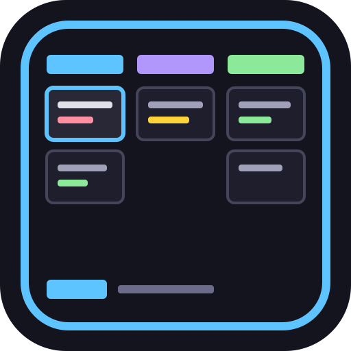

# tct — Terminal Card Tracker

A keyboard-driven TUI Kanban board built in Rust. Think Trello, but in your terminal — and **shared between you and your AI agents**.

Humans work in the TUI, agents and scripts in the headless CLI, and both edit the same boards (see [Humans and AI agents](#humans-and-ai-agents)).

tct stores everything as **plain JSON files** — one file per board and one per card (lists live inline in the board file). Put them in a git repo, Dropbox, or any synced folder and every team member sees the same boards. tct watches the filesystem and picks up changes automatically, making it a natural fit for **background file sync** workflows.

It also has **explicit git support**, so you don't have to manually commit if using git.


## Installation

### Homebrew (macOS Apple Silicon, Linux x86_64)

```sh
brew install waschmittel/tct/tct
```

### Prebuilt binary

Download a prebuilt binary for your platform from the
[GitHub releases page](https://github.com/waschmittel/tct/releases), then put it
on your `PATH`:

```sh
chmod +x tct
mv tct /usr/local/bin/
```

### First steps

```sh
tct init     # boards next to your code in ./.tct (or skip it to use ~/.tct)
tct          # board selector: press n for a new board, ? for help
```

## Build from source

Requires a Rust toolchain.

```sh
cargo install --path .
```

Or build and run directly:

```sh
cargo run
```

## Why tct?

- **Files are the API** — every board and card is a standalone JSON file. Human-readable, git-friendly, scriptable.
- **Sync-friendly by default** — one file per entity, atomic writes, periodic reload. Works with git, Dropbox, Syncthing, or any file sync tool.
- **Keyboard-first** — every action reachable via keyboard. Modal input (like Vim) keeps bindings contextual and safe.
- **Built for humans *and* agents** — the TUI and the CLI edit the same files, the binary documents itself (`tct --help user-guide`), and changes show up live on the human's screen.
- **Dual interface** — interactive TUI for humans, headless CLI for scripts and AI agents. Same data.
- **Zero infrastructure** — single binary. No database. No server. No account.

## Features

- Multiple boards with named lists and cards, reorderable and archivable
- Shift+Arrow card movement (within and across lists)
- Inline markdown description editor with syntax highlighting and word-wrap (80 chars)
- Markdown syntax highlighting (code blocks, headings, bold/italic/bold-italic, inline code, lists)
- Unified card detail view — description, checklist, labels, due date in one scrollable view
- Checklist CRUD — add, edit, toggle, delete, reorder items
- Board-level global labels with auto-generated pastel colors
- Due dates with overdueness display in both card list and detail view
- Description indicator (`≡`) in card list when a card has a description
- Card and board archiving with restore and permanent delete
- Search with non-matching cards hidden and label filtering
- Confirmation dialogs for destructive actions
- Undo/redo in description editor
- macOS Cmd key support (in supported terminals)
- Auto-continuing lists in editor
- Per-board configurable accent color (pastel palette cycle with 'c', or free HSL color picker with 'C')
- Periodic filesystem reload (every 15s) for background sync support
- PDF export of a card (PDF/A, fonts embedded, nothing to install) — black and gray for monochrome printers by default, or in color; long descriptions break across pages sensibly (see below)
- Full CLI interface for scripting and AI agent use (`tct --help`)

## Humans and AI agents

The goal: **people and AI agents working on the same board.** Humans use the TUI; agents and scripts use the CLI. There is nothing to host and nothing to configure — both sides read and write the same JSON files, and the TUI reloads every 15 seconds so an agent's new card appears on your screen.

```sh
tct cards "Sprint" --show "caching"                     # read the task
tct checklist "Sprint" "caching" --add "Write tests"    # plan
tct checklist "Sprint" "caching" --toggle 1             # report progress
tct commit                                              # record it in git
```

- Partial, case-insensitive name matching (and `--by-id` when exact); errors go to stderr with exit status 1.
- The binary documents itself: `tct --help user-guide --toc` and `--section <heading>` print the guide piece by piece.
- Output is sanitized, and everything under a discovered `.tct/` is treated as untrusted.

More, including a snippet for your `AGENTS.md`: `tct --help user-guide --section "Humans and AI agents"`.

## CLI Usage

tct can be used as a CLI tool without opening the TUI — useful for scripting or AI agent integration.

```
tct --help                              Overview and help topics (cli, examples, env, readme, user-guide)
tct --version                           Print the version and exit
tct --board <name>                      Open TUI directly on a matching board
```

Commands use the pattern `tct <entity> <board> --<action> [args]`. Board (and card for checklist) always come before the action flag. The default action for each entity is listing.

Name arguments use **case-insensitive partial matching** by default. Pass `--by-id` anywhere in the command to match all identifier arguments by **exact ID** instead of name. IDs are shown in listings as `[xxxxxxxx]`. Multiple name matches produce an error listing all candidates with their IDs.

Entities: `boards`, `lists`, `cards`, `checklist`, `labels`, `search`. Run `tct --help cli` for the full set of actions and flags, `tct --help examples` for a workflow, and `tct --help user-guide [--toc | --section <heading>]` for the complete guide — the README and guide are embedded in the binary for users and AI agents alike.

### Examples

A typical workflow from scratch:

```sh
# Create a board and lists
tct boards --create "My Project"
tct lists "My Project" --create "To Do"
tct lists "My Project" --create "In Progress"
tct lists "My Project" --create "Done"

# Add cards
tct cards "My Project" --create "To Do" "Fix login bug"
tct cards "My Project" --create "To Do" "Write tests"

# View the board
tct cards "My Project"

# Edit a card
tct cards "My Project" --edit "Fix login" --title "Fix login bug" --due 2099-12-31

# Add checklist items
tct checklist "My Project" "Fix login" --add "Reproduce the bug"
tct checklist "My Project" "Fix login" --add "Write a failing test"
tct checklist "My Project" "Fix login" --toggle 1

# Create and assign labels
tct labels "My Project" --create "bug"
tct labels "My Project" --assign "Fix login" "bug"

# Archive a finished card
tct cards "My Project" --archive "Write tests"
tct cards "My Project" --archived
```

Addressing items by ID (use `--by-id` when name matching is ambiguous):

```sh
# List boards to find the ID
tct boards
# Active boards (1):
#   [a1b2c3d4]  My Project   3 lists, 1 active cards

# Use ID for unambiguous operations (--by-id applies to all identifier args)
tct lists a1b2c3d4 --by-id
tct cards a1b2c3d4 --show e5f6a7b8 --by-id
```

## PDF export

Export the selected card — title, labels, due date, markdown description (tables
included) and checklist — as a PDF/A document. The fonts are built into the
binary, so it works the same on any machine.

- In the TUI press `p` for a **black-and-gray** PDF (the default, made for
  monochrome printers) or `P` for a **color** one, from the board view or the
  card detail. A small dialog asks where to save: type a path or browse folders
  with Up/Down and Tab. It starts in the folder you last exported to and
  suggests the card title as the file name.
- From the command line:

```sh
tct cards "My Project" --export "Fix login"                  # ./fix-login-bug.pdf, black and gray
tct cards "My Project" --export "Fix login" --style color    # same file name, in color
tct cards "My Project" --export "Fix login" --out ~/Desktop  # into a folder, or give a file name
```

In the [browser version](docs/docker/README.md) the same keys send the PDF to your
browser as a download instead of opening the save dialog.

A table whose top-left cell is empty is treated as a *matrix* (labels on the left
too): its first column is bold like the header and the empty corner is left open.
In the PDF, heavier lines separate the labels from the contents; matrices with
more than 3 content columns get thin column lines, and matrices with more than 8
rows get thin row separators (with thin top and bottom rules); without row
separators a matrix has no top or bottom border.

Sections, tables, code blocks and the checklist are kept together on a page where
they fit; long tables repeat their header row. Sample output for awkward inputs is
in [docs/export-examples](docs/export-examples/). A nicely laid-out example with
headings, lists, a table, a matrix, labels and a checklist:
[monochrome](docs/export-examples/00-showcase.pdf) ·
[color](docs/export-examples/color/00-showcase.pdf).

## Storage and Sync

Data is stored as JSON files. Storage location is resolved in this order:

1. `TCT_DATA_DIR` environment variable (if set) — the complete path of the data directory
2. A `.tct/` directory in the current working directory or any of its parents (project-local boards)
3. `~/.tct/` (global default)

This means you can keep project-specific boards alongside your code by running `tct init` in your project root (like `git init`; it also drops a README into `.tct/`).

```
.tct/  (or ~/.tct/)
  board_order.json        # Board display order
  boards/
    <board-id>/
      board.json          # Board metadata + ordered list definitions + labels
      card-<id>.json      # Card data: list_id, position, title, description, labels, ...
```

Each card owns its own list membership (`list_id`) and order within that list
(`position`, a fractional rank). Lists are just named entries in `board.json` —
there are no `list-*.json` files. This keeps a card's archived flag and its list
membership in a single file, so they cannot diverge.

All writes are atomic (write to `.tmp`, then rename) — no partial files, even on
crash. A `.version` file records the format; tct refuses to open a directory
written by a different format version rather than reading it partially.

### Setting up shared boards with git

```sh
mkdir .tct
echo ".tct/**/*.tmp" >> .gitignore
tct boards --create "Sprint Board"
git add .tct/ && git commit -m "Add project board"
```

Team members who pull will see the board when they run `tct` from that project directory. Different cards never conflict. tct auto-reloads from disk every 15 seconds.

`tct commit` commits `.tct/` (only it) with a message naming the boards and cards that changed; `tct --git enable` also does so when the TUI quits, and `C` in the board view commits at once. `tct init` turns this on by itself inside a git repository.

For detailed sync workflows (git, Dropbox, Syncthing), see the [User Guide](docs/user-guide.md).

All keybindings are discoverable in the TUI via the `?` help overlay, which is contextual to the current mode (or `F1` / `Ctrl+H` when editing a description).

## Documentation

- **[User Guide](docs/user-guide.md)** — detailed usage, sync workflows, troubleshooting, data format reference
- **[Self-Hosting & Browser PWA (Docker)](docs/docker/README.md)** — run `tct` in a browser as an installable PWA with Basic Auth or OAuth
- **[Architecture (arc42)](docs/arc42.md)** — system context, building blocks, runtime views, ADRs, quality scenarios
- **[Architecture (source tree)](docs/architecture.md)** — module layout and modal input dispatch overview

## License

[MIT](LICENSE). Third-party components are listed in [THIRD_PARTY_NOTICES.md](THIRD_PARTY_NOTICES.md).
