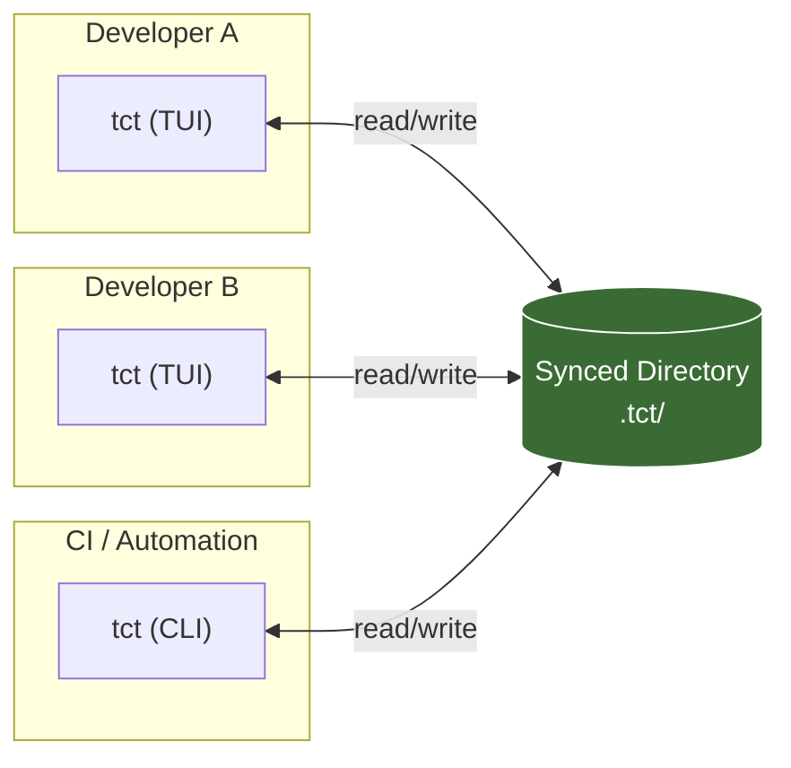
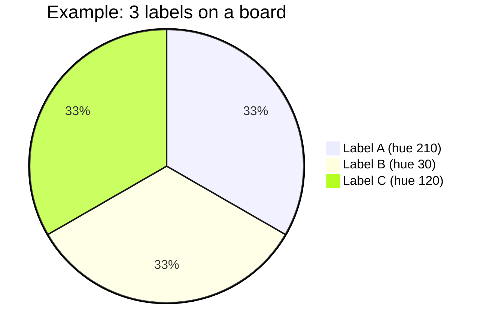
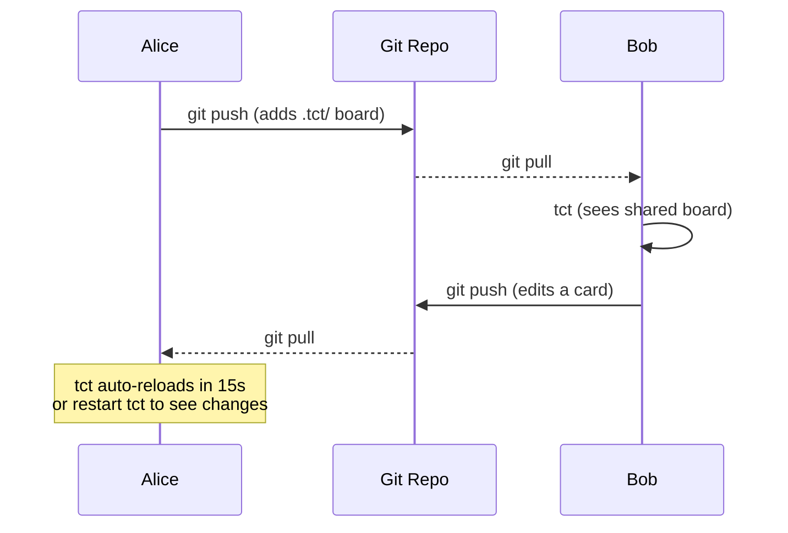
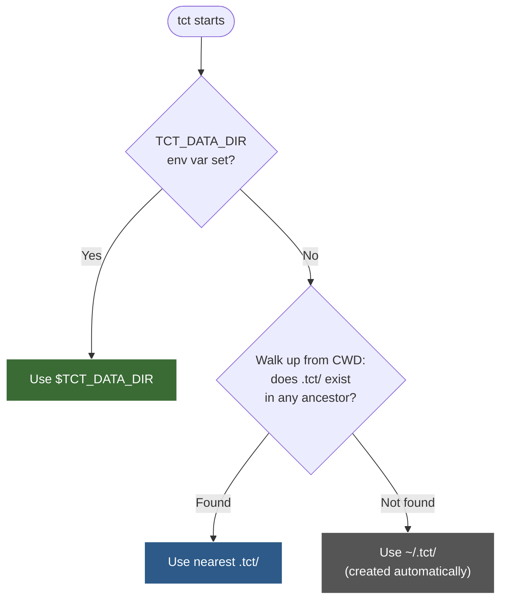
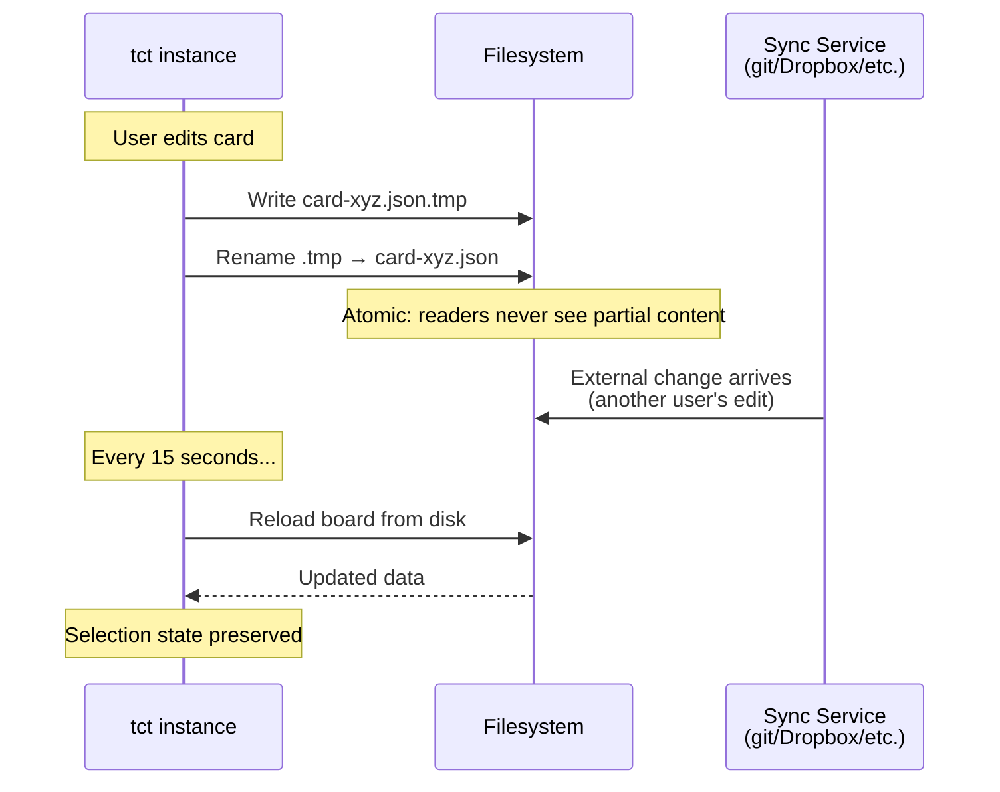

# tct User Guide — Terminal Card Tracker

## What is tct?

tct is a keyboard-driven Kanban board that lives in your terminal. It stores everything as plain JSON files on disk — no server, no database, no account.

The TUI is for people, the CLI for scripts — and for AI agents that share a board with you (see [Humans and AI agents](#humans-and-ai-agents)).

This matters because it means tct boards are **just files**. Put them in a git repo, a Dropbox folder, or any synced directory and every team member sees the same boards. tct watches the filesystem and picks up changes automatically, making it a natural fit for **background file sync** workflows.



### Design Principles

| Principle | What it means |
|-----------|--------------|
| **Files are the API** | Every board and card is a standalone JSON file (lists live inline in the board file). Any tool that can read/write files can interact with tct data. |
| **Sync-friendly by default** | One file per board and per card, atomic writes (write `.tmp` then rename), and periodic reload make tct safe for use with git, Dropbox, Syncthing, or any file sync tool. |
| **Keyboard-first** | Every action is reachable from the keyboard. No mouse needed. Modal input (like Vim) keeps keybindings contextual and safe. |
| **Dual interface** | The same data is accessible via interactive TUI or headless CLI. Scripts and AI agents use the CLI; humans use the TUI. Both read and write the same files. |
| **Zero infrastructure** | Single binary. No database. No network. Install and run. |

---

## Installation

### Homebrew (macOS Apple Silicon, Linux x86_64)

```sh
brew install waschmittel/tct/tct
```

### Prebuilt binary

Download a binary for your platform from the [releases page](https://github.com/waschmittel/tct/releases), then put it on your `PATH`:

```sh
chmod +x tct
mv tct /usr/local/bin/
```

### From source

Requires a Rust toolchain.

```sh
git clone https://github.com/waschmittel/tct
cd tct
cargo install --path .
```

Or build and run directly with `cargo run`.

### Verify

```sh
tct --help
```

Help topics: `tct --help cli` (commands and flags), `examples`, `env` (data directory and environment variables), and `readme` / `user-guide` — this guide, embedded in the binary. Both take `--toc` (table of contents only) or `--section <heading>` (one section, case-insensitive partial match), e.g. `tct --help user-guide --section "CLI Reference"`. Handy for AI agents.

### Your first board

```sh
cd ~/projects/my-app
tct init        # creates ./.tct, like `git init`
tct             # opens the board selector; press n to create a board
```

Without `tct init`, boards live in `~/.tct/`. See [Where data lives](#where-data-lives).

---

## TUI Quick Start

### Launch

```sh
tct                     # Open board selector
tct --board "Sprint"    # Open directly into a board (partial name match)
```

### Screens overview


### Board Selector

The first screen you see. Lists all active boards.

| Key | Action |
|-----|--------|
| Up / Down | Select board |
| Shift+Up / Shift+Down | Reorder board |
| Enter | Open selected board |
| n | Create new board |
| r | Rename selected board |
| c | Cycle board accent color |
| C | Configure board |
| a | Archive board |
| v | Archived boards |
| ? | Help |
| q | Quit |

### Board View (Kanban columns)

The main working screen. Shows lists as columns with cards stacked vertically.

**Navigation:**

| Key | Action |
|-----|--------|
| Left / Right | Switch list |
| Up / Down | Select card |
| g | Jump to first card |
| G | Jump to last card |

**Card actions:**

| Key | Action |
|-----|--------|
| Enter | Open card detail |
| t | Quick-edit card title (inline) |
| e | Edit card description |
| y | Copy card title |
| n | New card in current list |
| a | Archive card |
| h | Card history |

**Card movement:**

| Key | Action |
|-----|--------|
| Shift+Up / Shift+Down | Move card within list |
| Shift+Left / Shift+Right | Move card to next list |

**List management:**

| Key | Action |
|-----|--------|
| N | Create new list |
| r | Rename current list |
| A | Archive list |
| V | Archived lists |
| < (Shift+,) | Move list left |
| > (Shift+.) | Move list right |

**Labels & due dates:**

| Key | Action |
|-----|--------|
| l | Assign / remove labels |
| L | Open label manager |
| u | Set due date |
| U | Clear due date |

**Search & filter:**

| Key | Action |
|-----|--------|
| / | Open search bar |
| f | Filter by label |
| F | Clear filters |

**Other:**

| Key | Action |
|-----|--------|
| v | Archived cards |
| b | Board selector |
| ? | Help |
| q | Quit |

### Card Detail View

A full overlay showing all card properties: title, description, checklist, labels, and due date.

| Key | Action |
|-----|--------|
| t | Edit title |
| e | Edit description |
| PgUp / PgDn | Scroll description |
| y | Copy description |
| Y | Copy checklist as Markdown |
| Up / Down | Select checklist item |
| Shift+Up / Shift+Down | Reorder checklist item |
| Space | Toggle checklist item |
| a | Add new checklist item |
| Enter | Edit checklist item |
| x | Delete checklist item |
| l | Assign / remove labels |
| L | Manage board labels |
| u | Set due date |
| U | Clear due date |
| h | Card history |
| ? | Help |
| Esc | Close card detail |
| q | Quit |

### Description Editor

A Markdown editor with syntax highlighting: headings, bold, italic, inline code, code blocks, lists, blockquotes (`> text` per line, or between two `>>>` lines), alerts, footnotes, tables and strikethrough.

**Alerts** are quotes whose first line is a tag: `> [!note]` plus `> ` lines, or `>>> [!note]` … `>>>`. Kinds: `note` (blue), `tip` (green), `important` (purple), `warning` (gold), `caution` (red); unknown tags stay ordinary quotes. The read view shows the kind in bold capitals in the alert's color; the PDF adds a colored bar and GitHub's icon (black in the monochrome theme). In a quote, `Ctrl+G` then `n` `t` `i` `c` `w` makes it an alert or changes its kind; `x` makes it a plain quote again.

In the PDF, `...` becomes `…` and straight quotes become typographic ones (`„Hallo“`, `« bonjour »`, `“hello”`); code stays literal. The language is detected from the card's text (English, German, French, Spanish, Italian, Dutch, Portuguese, Swedish, Turkish; English when unsure) and also translates alert titles and fixed texts (section titles, dates). The export dialog shows it.

**Footnotes** work as on GitHub/GitLab: a reference `text[^1]` and a definition `[^1]: The note.` anywhere in the text; labels may be names (`[^my-note]`). A note continues on following lines and, after a blank line, in paragraphs indented by four spaces. Unpaired references or definitions, and anything in code, stay literal. The PDF prints each note at the bottom of every page that references it, under its name, or for numbered labels a count (1, 2, …) by first reference.

`Ctrl+N` inserts the next number as a reference at the cursor, renumbers the numbered footnotes to ascend by first reference (names and unpaired labels untouched), and jumps to the new definition, ready to type. In a definition it jumps back to the first reference. With text selected, the reference is named after it (`[^two-words]`; whitespace becomes `-`, max. 32 characters) and the text stays; an already defined name just jumps to its definition.

| Key | Action |
|-----|--------|
| F1 / Ctrl+H | Help |
| Ctrl+S | Save description |
| Ctrl+Q | Save and close |
| Ctrl+Z | Undo |
| Ctrl+Y | Redo |
| Ctrl+C | Copy selected text |
| Ctrl+X | Cut selected text |
| Ctrl+V | Paste from clipboard |
| Ctrl+N | Footnote: insert reference and jump to its definition (in a definition: jump back) |
| Ctrl+P | Paste mode on/off: plain text only (no list continuation, renumbering, table reflow); normalized when you leave it |
| Shift+Arrows | Select text |
| Ctrl+B | Toggle bold (`**text**`); without a selection in a table cell, formats the cell |
| Ctrl+E | Toggle italic (`*text*`); not `Ctrl+I`, which terminals send as Tab |
| Ctrl+K | Toggle inline code (`` `text` ``) |
| Ctrl+L | Insert list item |
| Up / Down | Move by visual (wrapped) line |
| Enter | Continue bullet / numbered list |
| Tab | Nest list item (or selected lines) |
| Shift+Tab | Un-nest list item (or selected lines) |
| Esc | Cancel (confirms if changed) |

Saving (`Ctrl+S` / `Ctrl+Q`) normalizes the text (tables, list indents, numbering; not fenced code) and writes only if something changed, which keeps history and sync free of noise. The cursor position is stored in the card and restored on the next edit.

On macOS, **Cmd** can substitute for Ctrl in terminals that support it (kitty, Alacritty, WezTerm).

#### Tables

A run of `|` lines whose second line is a delimiter row (`|---|---|`; `:--`, `:-:`, `--:` align) is a table, reformatted on every edit. `Tab` / `Shift+Tab` walk the cells (`Tab` in the last cell adds a row), `Enter` goes down a row, `Ctrl+T` inserts a skeleton, `Alt+arrows` / `Alt+Shift+arrows` move and add/delete rows and columns (`F1` lists all).

**Matrices.** A table with an empty top-left cell is a *matrix*: labels on the left as well as on top. Its first column is bold like the header and the corner is left open:

```
|       | Design | Build |
|-------|:------:|:-----:|
| Ada   | owner  | review|
| Grace | review | owner |
```

`Ctrl+T`, `t` *transposes* a matrix (other tables refuse it). Put text in the corner to get a normal table back. PDF details: [ADR-0013](adr/0013-matrix-tables.md).

### PDF export

`p` in the board view or card detail exports the selected card (title, labels, due date, description, checklist) as a PDF/A document, in black and gray for monochrome printers; `P` is the same in color. A dialog asks where to save: type a path or browse with Up/Down and Tab. It starts in the last export folder and suggests the card title as file name. In the browser version the PDF is downloaded instead.

Sections, the checklist, code blocks and tables stay together on a page where they fit; long tables repeat their header row. Samples: [`docs/export-examples/`](export-examples/).

### Search

`/` in board view opens the search bar; type a query and press Enter. Non-matching cards are **hidden**, navigation skips them, and the first match is selected. `f` filters by label; `F` clears all filters.

---

## Labels

Labels are **board-level**: defined once per board, then assigned to cards, so renaming or recoloring updates them everywhere.

### Creating labels

`L` opens the label manager, `n` creates a label: type a name, press Enter. The color is generated to be distinct from existing labels.

### Assigning labels to cards

`l` opens the label picker (board view or card detail): Up/Down to select, Space or Enter to toggle, Esc to close.

### Label colors

New labels get a pastel color whose hue is maximally distant from all existing label hues:



The label manager cycles through named presets (Red, Orange, Yellow, Green, Blue, Purple, Pink, Cyan).

### Label ordering

Cards show labels in **board-level order** (as in the label manager), not assignment order. Reorder them there with Shift+Up/Down.

---

## Due Dates

- `u` (card detail, or the selected card in board view) opens the calendar picker; `U` clears the date
- Picker: arrows move by day/week, PgUp/PgDn by month (Shift = year), `t` jumps to today, Home/End to the month's first/last day
- Or type the date (`YYYY-MM-DD`); the calendar follows as you type
- Enter saves, Esc cancels; an emptied buffer (Ctrl+U) plus Enter removes the date
- **Overdue** cards are marked in the card list and detail view
- Due dates show in CLI output (`tct cards <board>`) and search results

---

## Board Accent Colors

Each board has an accent color for all UI highlights; `c` in the board selector cycles it. New boards get one distinct from existing boards.

---

## Archiving

Archiving is a **soft delete**: data stays on disk but is hidden.

### Cards

| Action | How |
|--------|-----|
| Archive card | `a` in board view |
| View archive | `v` in board view |
| Restore | `Enter` in archive view |
| Permanently delete | `x` in archive view |

### Lists

| Action | How |
|--------|-----|
| Archive list | `A` in board view |
| View archive | `V` in board view |
| Restore | `Enter` in archive view |
| Permanently delete | `x` in archive view |

### Boards

| Action | How |
|--------|-----|
| Archive board | `a` in board selector |
| View archive | `v` in board selector |
| Restore | `Enter` in archive view |
| Permanently delete | `x` in archive view |

---

## CLI Reference

The CLI provides the same operations as the TUI, designed for scripting and AI agent integration.

### General pattern

```
tct <entity> <board> --<action> [args]
```

All name arguments use **case-insensitive partial matching** by default. Add `--by-id` anywhere to match by exact 8-character ID instead.

### Boards

```sh
tct boards                          # List active boards with card counts
tct boards --archived               # List archived boards
tct boards --create "Sprint 42"     # Create a new board
tct boards --archive "Sprint"       # Archive (partial name match)
tct boards --restore "Sprint"       # Restore from archive
tct boards --delete "Sprint"        # Permanently delete (must be archived first)
```

### Lists

```sh
tct lists "Sprint"                            # List all lists on board
tct lists "Sprint" --create "To Do"           # Create a list
tct lists "Sprint" --rename "To Do" "Backlog" # Rename a list
tct lists "Sprint" --delete "Backlog"         # Delete list + all cards
```

### Cards

```sh
tct cards "Sprint"                                    # List all cards by list
tct cards "Sprint" --list "To Do"                     # Cards in specific list
tct cards "Sprint" --archived                         # List archived cards
tct cards "Sprint" --show "Fix bug"                   # Full card detail
tct cards "Sprint" --create "To Do" "Fix login bug"   # Create card
tct cards "Sprint" --edit "Fix login" --title "Fix login flow"  # Edit title
tct cards "Sprint" --edit "Fix login" --due 2026-06-01          # Set due date
tct cards "Sprint" --edit "Fix login" --due none                # Clear due date
tct cards "Sprint" --edit "Fix login" --description "New desc"  # Set description
tct cards "Sprint" --export "Fix login"               # PDF to ./fix-login.pdf (black and gray)
tct cards "Sprint" --export "Fix login" --style color # Same, in color
tct cards "Sprint" --export "Fix login" --out ~/Desktop  # Into a folder, or give a file name
tct cards "Sprint" --archive "Fix login"              # Archive
tct cards "Sprint" --restore "Fix login"              # Restore
tct cards "Sprint" --delete "Fix login"               # Permanently delete
```

### Checklist

```sh
tct checklist "Sprint" "Fix login"                    # Show checklist
tct checklist "Sprint" "Fix login" --add "Write test" # Add item
tct checklist "Sprint" "Fix login" --toggle 1         # Toggle item 1
tct checklist "Sprint" "Fix login" --delete 2         # Delete item 2
```

### Labels

```sh
tct labels "Sprint"                                   # List all labels
tct labels "Sprint" --create "bug"                    # Create label
tct labels "Sprint" --delete "bug"                    # Delete (removes from all cards)
tct labels "Sprint" --assign "Fix login" "bug"        # Assign to card
tct labels "Sprint" --remove "Fix login" "bug"        # Remove from card
```

### Search

```sh
tct search "login"                            # Search all boards
tct search "login" --board "Sprint"           # Limit to one board
tct search "login" --board "A" --board "B"    # Multiple board filters
tct search "login" --list "To Do"             # Limit to lists matching name
tct search "login|auth" --regex               # Regex search
tct search "old task" --archived              # Include archived cards
```

Search matches against: card title, description, checklist item text, and label names.

### Commit

```sh
tct commit                      # Commit .tct to git, generated message
```

See [Git integration](#git-integration). `tct --git [enable|disable]` switches commit-on-quit.

### Using IDs

When name matching is ambiguous (multiple matches), tct shows all candidates with their IDs:

```
Error: Multiple cards match 'fix': Fix login [a1b2c3d4], Fix signup [e5f6a7b8].
```

Use `--by-id` to match by exact ID:

```sh
tct cards "Sprint" --show a1b2c3d4 --by-id
```

---

## Humans and AI agents

tct also works well when people and AI agents share a **board**. There is no API server to run and no integration to configure: the board is a directory of JSON files, humans use the TUI, and agents use the CLI (or read the files).

| | Humans | Agents and scripts |
|---|---|---|
| Interface | TUI (`tct`) | CLI (`tct cards …`) |
| Reads | Board view, card detail | `tct cards <board>`, `--show`, `tct search`, or the JSON files |
| Writes | Keyboard | `--create`, `--edit`, `--toggle`, `--assign`, … |
| Sees the other's changes | Automatically, within 15 seconds | On the next command |

Why this works well:

- **Self-documenting.** `tct --help` is a short overview; `tct --help cli`, `examples` and `env` give the full reference, and `tct --help user-guide --toc` / `--section <heading>` print this guide piece by piece. An agent needs no external documentation.
- **Forgiving addressing.** Boards, lists, cards and labels match by case-insensitive partial name; ambiguity is an error that lists the candidates with their IDs. Use `--by-id` for exact matches.
- **Predictable.** Errors go to stderr with a non-zero exit status. Control characters in titles are stripped from output, so a hostile card title cannot inject terminal escape sequences into an agent's or a human's terminal.
- **Live for humans.** The TUI reloads from disk every 15 seconds, so a card an agent creates appears on the human's screen without a restart. A reload never interrupts editing.
- **Reviewable.** Every card keeps a change history (`h` in the TUI), and `tct commit` records changes to `.tct/` in git, with a message that names the boards and cards touched. Nothing is committed in the background; the agent or human decides when.

### Example: an agent works through a task

```sh
# Pick up work
tct cards "Sprint" --list "To Do"
tct cards "Sprint" --show "caching"

# Plan it
tct checklist "Sprint" "caching" --add "Set up Redis connection"
tct checklist "Sprint" "caching" --add "Add cache middleware"
tct checklist "Sprint" "caching" --add "Write integration tests"

# Report progress
tct checklist "Sprint" "caching" --toggle 1
tct cards "Sprint" --edit "caching" --description "Redis for /api/users; TTL 60 s."

# Record it
tct commit
```

### Tell your agent about tct

Put a few lines in your agent instructions (`AGENTS.md`, `CLAUDE.md`, …):

```md
Track work on the tct board in `.tct/` (run `tct --help user-guide --section
"Humans and AI agents"` for how). Before starting, read your card with
`tct cards <board> --show <card>`; tick checklist items as you go; run
`tct commit` when you finish.
```

### Safety notes for shared repositories

`tct` treats every file under a discovered `.tct/` as untrusted: IDs are validated, symlinks are refused, and output is sanitized. Agents should still use the CLI instead of editing the JSON by hand, because the CLI keeps the per-card list membership, order and history consistent.

---

## Workflows

### Solo developer — project-local board

```sh
cd ~/projects/my-app
mkdir .tct
echo ".tct/**/*.tmp" >> .gitignore

tct boards --create "My App"
tct lists "My App" --create "To Do"
tct lists "My App" --create "In Progress"
tct lists "My App" --create "Done"

# Work in TUI
tct --board "My App"
```

### Team — shared boards via git



Best practices for git-synced boards:

1. Add `.tct/**/*.tmp` to `.gitignore`
2. Commit `.tct/` along with code changes
3. Different team members should avoid editing the **same card** simultaneously — different cards are conflict-free
4. If a merge conflict occurs, pick either version (each file is self-contained)

### CI / Automation — CLI scripting

```sh
#!/bin/bash
# Create a card for each failing test
tct boards --create "CI Results" 2>/dev/null
tct lists "CI Results" --create "Failures" 2>/dev/null

for test in $(cat failing_tests.txt); do
    tct cards "CI Results" --create "Failures" "FAIL: $test"
done
```


### AI agent integration

See [Humans and AI agents](#humans-and-ai-agents).

---

## Storage and Sync

### Where data lives

tct resolves its data directory in this order:



This means:

- **Global boards** live in `~/.tct/` — your personal default
- **Project-local boards** live in a `.tct/` directory inside (or above) your project — shared with anyone who clones the repo
- **Custom location** via `TCT_DATA_DIR` — useful for testing or pointing at a sync folder
- **`tct init`** — like `git init`: creates `.tct/` (plus a `README.md` explaining it) in the current directory, or at `$TCT_DATA_DIR` if that is set. Safe to re-run; an existing README is never overwritten
- Only `~/.tct/` is created implicitly (with the same `README.md` as `tct init`). A `TCT_DATA_DIR` that does not exist is an error ("run `tct init`"), so a typo cannot silently start a fresh data directory
- tct exits with an error if the current directory no longer exists (except `tct init` with `TCT_DATA_DIR` set)
- **`tct init --git enable|disable`** — also decides on [git integration](#git-integration) and says what it chose: enabled when the new `.tct/` is inside a git repository that does not ignore it, disabled otherwise; the flag overrides, a re-init keeps an existing setting

`TCT_DATA_DIR` is the *complete* path of the data directory — `.version` and `boards/` go directly into it, nothing is appended. It may be a symlink (your own choice; a *discovered* `.tct` must be a real directory).

### Environment variables

| Variable | Effect |
|---|---|
| `TCT_DATA_DIR` | Complete path of the data directory. Wins over the `.tct` search and `~/.tct`. Must exist — create it with `tct init`. |
| `TCT_SKIP_CORRUPT` | Any value other than empty or `0`: skip unreadable board/card files and load the rest instead of failing. Single-file loads still fail. |
| `TCT_WEB` | Set by the Docker/ttyd image: PDF export streams to the browser instead of asking for a path. |
| `TERM`, `COLORTERM` | `COLORTERM=truecolor`/`24bit` gives full color, otherwise 256 colors; `TERM=linux` gets 16 colors and console-safe glyphs. |

### File layout

```
.tct/
  .version                         # Persistence format version (a single integer)
  boards/
    a1b2c3d4/                      # One directory per board — the name is the board's ID
      board.json                   # Board metadata: name, inline lists, labels, accent color
      card-11223344.json           # Card: list_id, position, title, description, checklist, labels, due date
      card-55667788.json
    b2c3d4e5/                      # Another board
      board.json
      ...
```

Lists are defined inline in `board.json`; there are no `list-*.json` files. A
card owns its own list membership (`list_id`) and order (`position`), and a
board owns its own place in the selector (`position`). A record's ID is its
path — the board's directory name, the card's file name — so it is not
repeated inside the file. This is deliberate:

- **Granular diffs** — changing one card produces a one-file diff, not a monolithic database change
- **Conflict-friendly** — two people editing different cards never conflict, even without locking
- **Human-readable** — open any `.json` file in an editor to inspect or fix data
- **No divergence** — a card's archived flag and its list membership live in one file, so they cannot disagree (see ADR-0006)

### Setting up background sync

#### With git (recommended for teams)

```sh
# In your project root:
mkdir .tct
echo ".tct/**/*.tmp" >> .gitignore   # Exclude atomic-write temp files

# Use tct normally — boards are created inside .tct/
tct boards --create "Sprint Board"

# Commit and push
git add .tct/
git commit -m "Add project Kanban board"
git push
```

Team members who pull will see the board when they run `tct` from that project directory.

#### Git integration

tct can commit `.tct/` for you — explicitly, never in the background:

```sh
tct commit                  # commit .tct now (same as commit-on-quit)
tct --git enable            # also commit when the TUI quits
tct --git disable
tct --git                   # show the setting
```

In the TUI board view, `C` commits now (works with commit-on-quit off). The CLI's other commands never commit.

- **Only `.tct/` is committed** — whatever else you have staged stays staged and out of the commit.
- **Messages use titles**: `Board "Sprint": card "Fix login" moved to "Done"` for a single change, `Board "Sprint": 3 cards updated` or `Boards "A", "B" updated` plus one line per change otherwise.
- The setting is local git config (`tct.autocommit`), so each clone opts in separately; it is not stored in `.tct/`.
- Commits skip hooks and signing so they never block, and are refused during a merge, rebase, cherry-pick or revert. A failed commit-on-quit prints a warning.
- Needs `git` on the `PATH`, an identity (`user.name`/`user.email`), and a `.tct/` that is not git-ignored.

#### With Dropbox / Syncthing / OneDrive

```sh
# Option 1: Put .tct/ inside a synced folder
cd ~/Dropbox/my-project
tct init
tct

# Option 2: Point TCT_DATA_DIR at a synced location
export TCT_DATA_DIR=~/Dropbox/shared-boards
tct
```

#### How sync safety works



Key safety properties:

| Property | Mechanism |
|----------|-----------|
| **No partial reads** | Atomic write: `.tmp` then rename. Readers always see complete files. |
| **No edit loss during reload** | Reload skipped while editing description, in dialogs, or in insert mode. |
| **Selection preserved** | List/card selection indices survive reload. |
| **No file locking needed** | One file per entity; only conflicting edits to the same card require manual merge. |

---

## Troubleshooting

### tct uses wrong data directory

Check which directory tct resolves:

1. Is `TCT_DATA_DIR` set? → `echo $TCT_DATA_DIR`
2. Is there a `.tct/` directory in the current directory or any parent? → `ls -la .tct/`
3. Otherwise it falls back to `~/.tct/`

### Changes from another user don't appear

tct reloads from disk every 15 seconds, but only in safe modes (board view, card detail, help). If you're in the middle of editing, reload is paused to prevent data loss. Close any editor/dialog and wait up to 15 seconds, or restart tct.

### Merge conflict in .tct/ files

Each file is self-contained JSON. For card conflicts: pick one version (or merge the JSON manually). For `board.json` conflicts: the `lists` array may need manual merging if both sides added/reordered/renamed lists.

### Card or list missing after sync

Check if the file exists on disk:

```sh
ls .tct/boards/*/card-*.json
```

A card is shown only if its `list_id` names a list in `board.json`. If a card is missing, open its `card-*.json` and check that `list_id` matches an `id` in the board's `lists` array (and that `archived` is `false`). Fix the `list_id` to re-home an orphaned card.

### macOS Cmd key not working

Cmd key support requires a terminal that sends Super modifier events. Supported: kitty, Alacritty, WezTerm. Not supported: Terminal.app, iTerm2 (use Ctrl instead).

---

## Appendix: Data Formats

### board.json

```json
{
  "name": "Sprint 42",
  "position": 1.0,
  "lists": [
    { "id": "e5f6a7b8", "name": "To Do", "archived": false },
    { "id": "c9d0e1f2", "name": "Done", "archived": false }
  ],
  "labels": [
    { "id": "11112222", "name": "bug", "color": "red" },
    { "id": "33334444", "name": "feature", "color": { "custom": { "r": 170, "g": 200, "b": 255 } } }
  ],
  "accent_color": { "custom": { "r": 186, "g": 255, "b": 186 } },
  "archived": false,
  "created_at": "2026-05-01T10:00:00Z",
  "updated_at": "2026-05-14T15:30:00Z"
}
```

Lists live inline in `board.json` (the `lists` array above) — there are no
`list-*.json` files. A list's cards are every `card-*.json` whose `list_id`
matches the list's `id`, ordered by ascending `position`.

### card-\<id\>.json

```json
{
  "list_id": "e5f6a7b8",
  "position": 1.0,
  "title": "Fix login bug",
  "description": "Auth token expires too early.\n\n## Steps to reproduce\n1. Login\n2. Wait 5 minutes\n3. Token is invalid",
  "label_ids": ["11112222"],
  "description_cursor": [4, 12],
  "due_date": "2026-06-01",
  "checklist": [
    { "text": "Reproduce issue", "completed": true },
    { "text": "Write failing test", "completed": false },
    { "text": "Fix token expiry logic", "completed": false }
  ],
  "archived": false,
  "created_at": "2026-05-01T10:00:00Z",
  "updated_at": "2026-05-14T15:30:00Z"
}
```

`description_cursor` (`[row, column]` of the editor's cursor at the last save) is optional and absent until a description is saved from the editor.

Neither file carries an `id`: a board's ID is the directory it lives in and a
card's is its file name, so renaming or moving the file re-IDs the record.

### .version

```
1
```

The persistence format this directory uses. tct refuses to open a directory
written by a newer version rather than reading it partially, and refuses an
older format rather than converting it silently.
